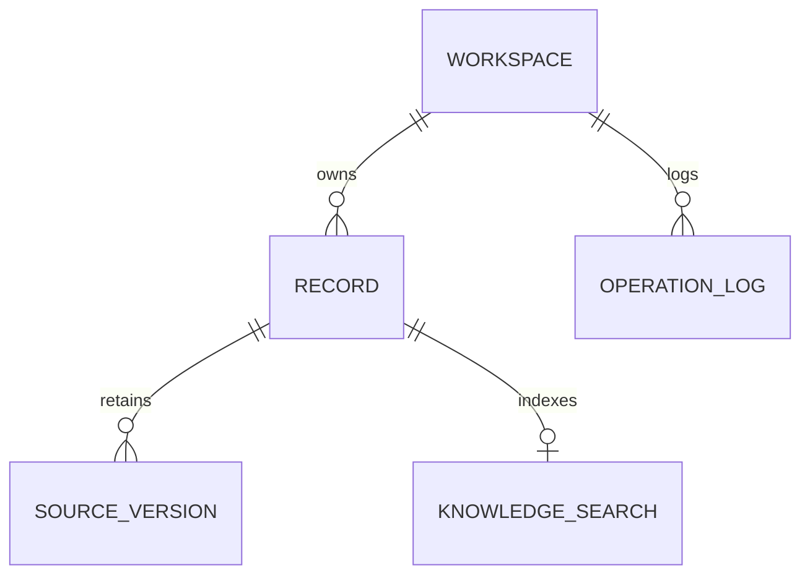

# 实现架构与数据设计

## 运行架构

React + TypeScript 提供界面和共享领域逻辑；Vite 将脚本、样式、示例数据、图标和 SVG 打包成一个 HTML。FastAPI 提供校验、会话、持久化、全文检索及模型请求，SQLAlchemy 管理 SQLite 事务。

在线版使用服务端存储；单文件版本通过同一仓储接口使用 IndexedDB。预览或 file 协议下从初始化开始禁止调用在线接口。在线连接失败明确报错，不静默切换成本地保存。

数据库在产品持久目录中，不在临时盘。由于运行卷可能是 NFS，SQLite 使用 DELETE journal 与写锁超时，而非依赖共享内存的 WAL。锁定依赖记录在 requirements.lock 和 package-lock.json。启动脚本检查依赖和前端产物，缺失时重建。

## 逻辑数据模型

本版使用有类型的记录载荷保存知识、专家、来源、考证、稿件、项目、任务和便笺；载荷由 kind 区分。公共字段为 UUID、标题、正文、分类、标签、状态、来源、关系、版本、时间和示例标记。扩展字段包括 era/place、role/quote、projectId/due、format/citations。

在轻量 MVP 中，这些领域对象保存在 records 的 JSON 载荷内，以相同事务和版本规则处理。它们不是独立 SQL 表；后续需要复杂跨对象查询时，按领域拆表而不更换对外仓储接口。

| 物理表 | 主键/索引 | 主要字段与约束 |
| --- | --- | --- |
| workspaces | id；token_hash 唯一索引 | 创建时间、会话令牌的 SHA-256，不保存原始令牌 |
| records | workspace_id + id；kind 索引 | kind、payload、version；修改携带当前版本，冲突返回 409 |
| source_versions | workspace_id + record_id + version | 完整不可变快照、正文哈希；覆盖来源不会修改旧引用 |
| operation_log | id；workspace_id 索引 | 创建/更新、对象编号、时间，不记录密钥或模型请求正文 |
| knowledge_search | FTS5 trigram 虚表 | 空间、记录编号、标题、正文、标签；与写入处于同一事务 |

一条引用包含 id、version、title、quote，考证可附 support/conflict。来源与对象按当前空间读取；缺失来源明确提示。归档更新 archived 标记，保留所有历史与既有引用。完整备份包含当前记录和历史快照，恢复采用全事务替换，失败回滚。

## 接口

所有写接口要求同源与 X-Qisushuo: workspace。会话使用随机令牌、HttpOnly、SameSite=Lax Cookie，HTTPS 时启用 Secure。业务接口每次从会话解析空间，不能使用客户端传入的空间编号越权。

| 接口 | 用途 |
| --- | --- |
| GET /api/health | 可用性检查 |
| GET /api/bootstrap | 创建/继续空间，返回记录及模型配置是否存在 |
| POST /api/records | 新建/更新领域对象，版本冲突返回 409 |
| GET /api/records/{id}/versions | 当前空间内对象的历史版本 |
| POST /api/imports | 单事务导入最多 500 条记录 |
| GET /api/search?q= | FTS5 + 中文短词参数化查询 |
| POST /api/assistant | 基于资料检索的问答或写作整理 |
| GET /api/export | 当前空间的完整备份 |
| POST /api/restore | 校验并恢复完整备份 |

知识图谱由当前记录的 relatedIds/sourceIds 实时推导，编辑关系后立即更新。前端在已加载资料中进行交互式检索，后端另提供空间隔离的全文检索接口。

## 导入与模型数据流

Markdown 导入读取 frontmatter、标题、tags、aliases、时代、地点、相对文件路径及原文。双链按完整路径、同目录路径、唯一标题/别名依次匹配；歧义与缺失目标只报告，不随意连边。同路径且原文相同跳过，内容变化创建新版本。单文件上限 2MB，一批最多 500 份。

问题首先在当前空间内召回相关资料，排除低价值通用词，仅将最多 6 条相关片段发送模型。服务端从环境读取凭据和模型名，优先 Responses 协议，明确不支持时使用兼容 Chat Completions。返回需包含正文、引用编号；不存在的引用被拒绝，回退为可核对的摘录。无资料时直接返回资料不足，不调用模型。调用超时或服务不可用时说明已切换到摘录模式。

不执行导入资料中的指令，不提供任意 URL 抓取。Markdown 原始 HTML 关闭并再次通过 DOMPurify 清理。静态路由不公开代码、依赖、数据库或配置。密钥不进入客户端、日志正文、备份或 Git。

## 验证与维护

后端测试覆盖访客隔离、版本冲突、短词与特殊字符检索、批量导入回滚、归档来源、完整备份恢复、安全校验和无证据回答。浏览器测试复用用户的共享浏览器，检查手机与桌面布局、主要业务流程及页面异常。前端每次更新后重新生成单文件体验，保持与在线界面一致。

首版尚不包含账户找回、多用户权限、自动同步与 PDF/OCR。浏览器会话被清除后需要用导出的备份恢复资料。知识检索基于全文与术语匹配，并未将其标为向量语义搜索。
