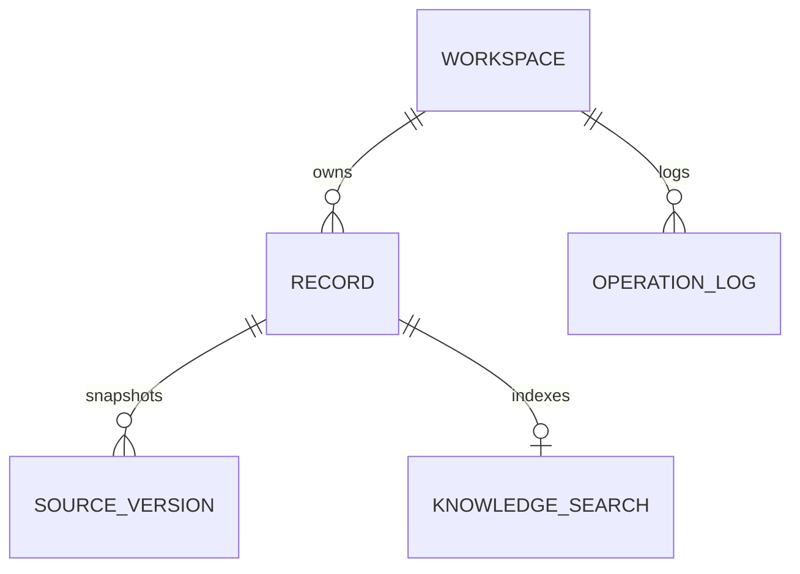

# 数据库与领域设计

## 已实现的物理模型

SQLite 文件为产品目录下 `data/research.sqlite3`，由 SQLAlchemy 管理。初始化以源代码模型为准，启动时创建缺失表；本版没有对存量数据做破坏性迁移。共享卷采用 DELETE journal 和 20 秒锁等待。

| 表 | 字段 | 约束与职责 |
| --- | --- | --- |
| workspaces | id、token_hash、created | id 主键；token_hash 唯一索引；会话令牌只保存 SHA-256 |
| records | workspace_id、id、kind、payload、version | workspace_id + id 复合主键；kind 索引；每个对象当前状态 |
| source_versions | workspace_id、record_id、version、payload、content_hash | 三字段复合主键；完整版本快照；正文 SHA-256 |
| operation_log | id、workspace_id、action、record_id、created | id 主键；空间索引；记录创建和更新，不记录密钥 |
| knowledge_search | workspace_id、record_id、title、body、tags | FTS5 trigram；前两项不分词；事务内同步索引，归档后移除 |

逻辑空间归属由每次会话查询强制限定，MVP 没有为这些表声明 SQL 外键，不将应用层隔离描述为数据库级行权限。未来规范化迁移将补齐复合外键与约束。

## 领域对象及载荷

`kind` 为受校验的枚举：knowledge、expert、source、evidence、draft、project、task、note。MVP 共用 `records` 表的 JSON 载荷，领域对象没有被错误地描述成八张独立物理表。

| 字段 | 类型 | 规则 |
| --- | --- | --- |
| id | string | 当前空间唯一，1–100 位英文、数字、下划线或短横线 |
| title、body | string | 标题 1–200 字；正文最多 2MB |
| kind | enum | 类型创建后不可变 |
| category、era、place、status | string | 分类、时代、地点、工作流状态；由对应界面展示 |
| tags | string[] | 标签；写入时校验类型和数量 |
| relatedIds | string[] | 知识关联；视图按无向关系去重；不推断关系事实 |
| sourceIds | string[] | 当前资料依据；呈现方向，不能替代锁定版本的引用 |
| citations | object[] | 锁定 `id, version, title, quote`；考证可附 `stance: support/conflict` |
| example、favorite、archived | boolean | 示例身份、收藏、软归档；示例标记随导出保留 |
| version | integer | 创建从 1 开始，修改提交原版本；冲突返回 409 |
| created、updated | ISO string | 创建时间与最近更新时间 |
| role、quote | string | 专家研究方向与档案观点；示例不是授权背书 |
| projectId、due、format | string | 稿件/任务/考证归属、计划日期、创作形式 |
| path、raw、aliases、unresolvedLinks | string / array | 导入相对路径、原文、别名、未解析双链 |

## 一致性与来源规则

写入对象、保留快照、写操作记录与更新搜索索引处于一个事务。批量导入中任意条目校验失败，该批次回滚。前端保存使用版本校验，避免另一个页面的修改被无提示覆盖。

当前 `sourceIds` 指向当前对象；`citations` 指向历史版本，二者语义不同。点击回答或稿件引用时通过 `/api/records/{id}/versions` 读取对应快照。来源归档后，历史引用仍然有效。永久删除尚未实现，界面使用可恢复归档。

图谱只消费当前空间有效的 knowledge/expert/source；只连实际存在的端点；排除自连与缺失端点。`relatedIds` 视为对称知识联系并去重，`sourceIds` 为方向性资料依据；两种关系允许在同一对象对之间并存。显示最多 60 个节点，不伪装成无限规模图计算。

## 备份与恢复

备份格式：`format: qisushuo-backup, schema: 1, records, revisions, exported_at`。备份不包含会话令牌、用户凭据或模型密钥。恢复先校验格式、类型、数量、唯一编号和版本，再在事务中替换当前空间的数据和索引；失败回滚。

备份含用户原文，应当按真实资料自身的使用范围管理。备份不会自动发送到外部存储。在线与离线存储可用相同格式迁移，但不自动合并或同步。

## 未来规范化模型（尚未实现）

迁移以记录稳定 ID 和历史引用不变为前提，先双写比对，再切换读取，最后停止旧写入。对象规模和团队需求没有出现前无需提前拆服务。

| 新表 | 核心键 | 目的 |
| --- | --- | --- |
| users、organizations、memberships | user / organization / role | 账号找回、团队角色与隔离 |
| knowledge_items、expert_profiles、documents | workspace_id + id | 领域字段约束与高频查询 |
| document_versions、document_chunks | document_id + version + chunk | 附件版本、OCR、页码与段落定位 |
| relations | workspace_id + from_id + to_id + predicate | 本体关系、关系证据、建立者和审核状态 |
| citations | artifact_id + source_id + source_version + locator | 稿件段落与来源定位，支持章节、页码、字符范围 |
| projects、tasks、project_artifacts | workspace/project/id | 项目独立授权、任务归属与成果挂接 |
| retrieval_runs、generation_runs | workspace_id + run_id | 召回片段、模型版本、引用、成本和质量评测 |
| review_decisions、audit_events | artifact_version + reviewer | 审核结论、发布版本、可检查审计 |

目标基础设施为 PostgreSQL + pgvector + 对象存储；索引任务通过持久队列异步执行。三维图谱继续读取领域关系，R3F 只负责交互显示，与存储引擎解耦。
